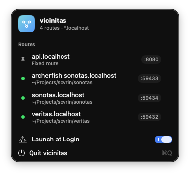

# vicinitas

Named `*.localhost` URLs for local dev servers, with a macOS menu bar app that lists them.

Wrap your dev command with `vici`. It picks a free port, starts the server on it, and registers the server as `<name>.localhost`. The menu bar app proxies that name to the port for as long as the server runs.



## Usage

```sh
vici nuxt dev                 # → http://<package name>.localhost
vici --name shop nuxt dev     # → http://shop.localhost
vici add api 8080             # fixed route to a server started some other way
vici rm api                   # remove a fixed route
vici ls                       # list routes
vici open [name]              # open in the browser (default: this project)
vici stop [name]              # stop a running dev server (default: this project)
```

- **Names.** By default the name comes from `package.json` (scope dropped) or the folder name. In a linked git worktree the worktree's folder is prepended, so `archerfish.sonotas.localhost` and `sonotas.localhost` can run side by side.
- **Ports.** The dev server gets the port through `PORT` and `NUXT_PORT`. If `PORT` is already set, that port is used.
- **Lifetime.** A route lives as long as its `vici` process. When the process exits, however it exits, the route goes away.
- **Menu bar.** Click a route to open it. Hover a route to stop its dev server or remove a fixed route. Right-click it to copy the link or show the folder. The app can start at login.

Add it to a project as a script:

```json
"scripts": {
  "dev:vici": "vici nuxt dev"
}
```

## How it works

- **DNS:** none needed. macOS resolves `*.localhost`, nested names included, to loopback.
- **Proxy:** the app runs [Caddy](https://caddyserver.com) on port 80 and updates its routes through Caddy's admin API on `localhost:2999`.
- **Registration:** `vici` connects to a Unix socket at `~/Library/Application Support/Vicinitas/vicinitas.sock` and keeps the connection open while the server runs. If the app starts later or restarts, `vici` registers again on its own.
- **Fixed routes:** stored in `fixed-routes.json` in the same folder.

## Requirements

- macOS 26 or later
- Caddy: `brew install caddy`
- Node.js for the CLI
- Xcode 27 or later to build the app
- Port 80 free

## Install

```sh
app/build.sh          # builds app/Vicinitas.app
open app/Vicinitas.app
cd cli && npm link    # installs the vici command
```
